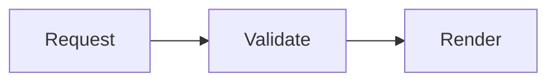

# Diagrams

## Context

Mermaid is show-me's only diagram language. The same source works in both places an artifact can live: a fenced block inside a Markdown document, or a `pre.mermaid` block inside an HTML artifact. Show-me renders it, applies one palette, and reports its own parse failures.

Read this file when a diagram explains the subject faster than prose or a card grid, and before writing diagram source.

## Instructions

### Choose a diagram over prose

* Use a diagram for relationships, flow, sequence, hierarchy, or state: system boundaries, a request's path, a decision tree, an entity model, a rollout order.
* Keep one diagram per idea. Two readable diagrams beat one graph that needs panning to understand.
* A Markdown document whose body is a single fence is a complete diagram artifact: the reader adds the document tree and comments, so the user can annotate the diagram's section.

### Render a diagram in Markdown

Write a fence whose language is `mermaid`:

````markdown

````

* The diagram renders in place, in every served `.md` document, with no marker or setup.
* Other fences keep their ordinary code rendering, and `?raw=1` still returns the untouched source.
* Keep a heading above each diagram: the reader's comments attach to sections, and a diagram below a heading is part of that section.

### Render a diagram in an HTML artifact

Include the shared runtime once, then write the diagram as markup:

```html
<script type="module" src="/_show-me/diagrams-auto.js"></script>

<pre class="mermaid">
flowchart TD
  Request --> Validate --> Render
</pre>
```

* The include is deferred, so it works in `<head>` or at the end of `<body>`.
* Never add a Mermaid script tag, version, CDN URL, theme variables, or `initialize` call. The shared runtime owns them; repeating them makes artifacts drift apart.
* The include requires the show-me server. An artifact opened as a local file shows the diagram source instead of rendering it.
* Put the diagram in a `<figure>` with a `<figcaption>` that states what it shows, matching the artifact template.

### Pick the diagram type

* `flowchart` for a process, pipeline, or decision tree.
* `sequenceDiagram` for messages between participants over time.
* `stateDiagram-v2` for states and transitions.
* `classDiagram` for types and their relations.
* `erDiagram` for data entities and cardinality.
* `gantt` for a schedule with durations.
* `timeline` for ordered events without durations.
* `mindmap` for a hierarchy of topics.
* `pie` for a small set of proportions.
* `quadrantChart` for items positioned on two axes.

### Write source that parses

* Quote a node label that contains brackets, parentheses, colons, or arrows: `A["Retry (max 3)"]`, `B{"Done?"}`.
* Keep labels short. A label that needs a sentence belongs in surrounding prose.
* Use plain text in labels. HTML and Markdown inside a label are not rendered.
* Do not add `%%{init}%%` directives or frontmatter configuration. Security-relevant settings stay fixed at the runtime, and a per-diagram theme fights the shared palette.
* Prefer `flowchart TD` for tall content and `flowchart LR` for a wide chain the user can scroll.
* Split a graph that grows past roughly fifteen nodes into several diagrams.

### Work within the rendering limits

* One diagram is capped around 50,000 characters and 500 edges. Split larger graphs instead of adding configuration.
* A wide diagram keeps its natural size and scrolls inside its own box; a tall one caps at about 70% of the viewport height. Both stay readable without page-level scrolling.
* A diagram that fails to parse is replaced by an error message and its own source. Read the reported line, fix the source, and reload; a failed diagram never hides the rest of the document.
